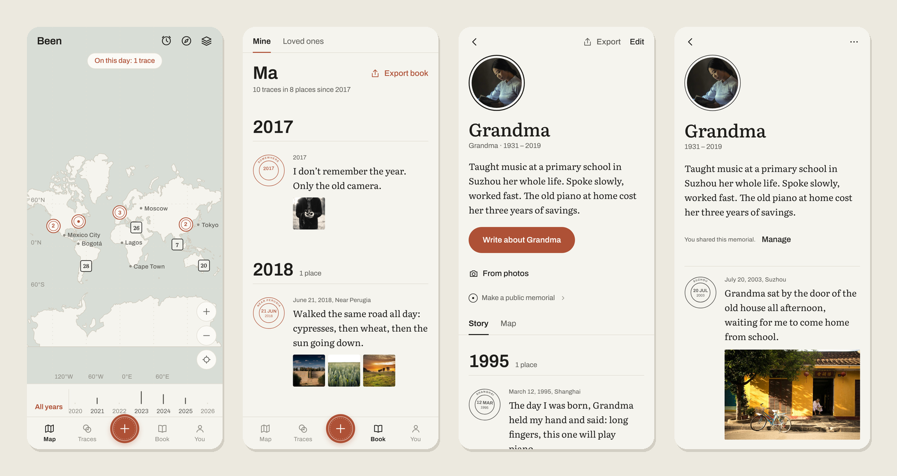
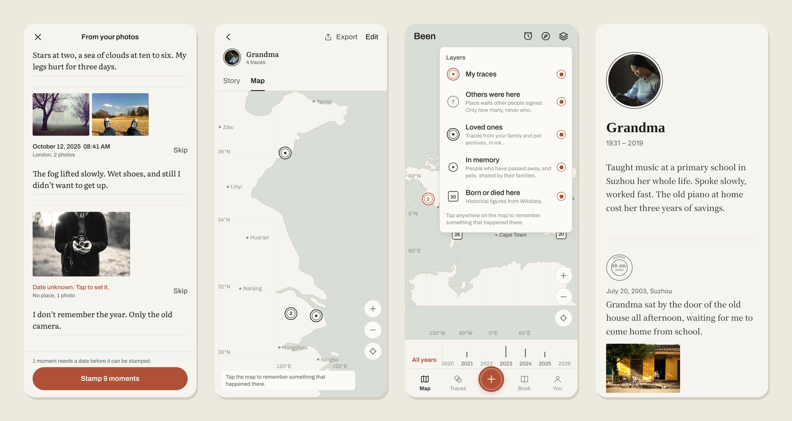

<div align="center">

# Been · 来过

**Leave a trace that you were here.**

English · [简体中文](README.zh-CN.md)

[](LICENSE)


</div>



Been is an app that does one thing: it keeps a record of **when** you were somewhere, **where** it was, and **what** you left there. Each trace is a small postmark on a map. Over the years they bind themselves into a book of your life.

It is also a place to keep the people and animals you have lost, and to quietly let the world know they were here.

## What Been believes

- **One thing, done well.** No check-ins, streaks, feeds, likes or badges. The old version of Been had all of that, and it was too heavy.
- **Discovering, not interacting.** You can see that other people were here before you, and who was born or died in a city a hundred years ago. You don't need to reply to anyone.
- **Your device first.** Everything is stored on your phone or in your browser and works fully offline. Syncing is optional.
- **Outlive the app.** Export your book as a single HTML file, with photos inside, that any browser can open in ten years. Export everything as open JSON.
- **Free to run.** The default map is an offline paper map drawn from public-domain data. Google Maps is optional, and "see photos and reviews" opens the user's own Google Maps app instead of calling paid APIs.

## Features

| | |
| --- | --- |
| **Traces on a map** | Tap anywhere on the map to remember something that happened there, today or forty years ago. Only remember the year? That's fine. |
| **Paper map** | An offline world map from Natural Earth: coastlines, borders and 1,251 cities in English and Chinese. Pan, zoom, no key needed. Google Maps on iOS and Android when a key is configured. |
| **From your photos** | Pick up to 50 photos. Been reads when and where each was taken from EXIF, groups them into moments (same day, within 1 km), and lets you add a line to each. Photos stay on the device. |
| **The book** | Your traces bound by year, as chapters. Export to a single offline HTML book. |
| **Time machine and teleport** | Go back to this day 1, 5 or 10 years ago, or to a random day. Teleport to any city and see who was there. |
| **Place walls** | When you are physically somewhere today, you can sign its wall: "you are the 27th person to be here", with one line of up to 60 characters. Others only see how many, never who. |
| **Historical figures** | 386 people born or died in 18 cities, from Wikidata (CC0). |
| **Loved ones** | Separate archives for family, friends and pets, each with its own portrait, years, story, book and map, kept apart from your own traces. |
| **Public memorials** | For people who have passed away, and for pets: a quiet public page with the traces you choose, an ink ring on the map, and a link that opens in any browser. No flowers, comments or counts. |
| **Everywhere** | iOS, Android and Web from one codebase. English and Chinese. Light and dark. |



## How it's built

| Part | Stack |
| --- | --- |
| App | [Expo](https://expo.dev) SDK 58 · React Native 0.88 · React 19 · expo-router · React Compiler |
| Local data | expo-sqlite (SQLite on device, WebAssembly SQLite on the web) · outbox for sync |
| Map | Hand-drawn SVG paper map (Natural Earth) · react-native-maps with Google on device · `@vis.gl/react-google-maps` on the web (optional) |
| Server | [Hono](https://hono.dev) on Cloudflare Workers · D1 (SQLite) · R2 for photos |
| Shared core | `packages/core`: zero-dependency TypeScript for the data model, sync, the book, postmark geometry, export, memorials. Unit tested with `node --test`. |

Sync is last-write-wins with tombstones and a per-user sequence counter. It is simple enough to be obviously correct, which is what you want for something meant to last. Design notes, in Chinese, are in [`docs/DESIGN.md`](docs/DESIGN.md) and [`docs/PLAN-v0.2.md`](docs/PLAN-v0.2.md).

```
apps/mobile     Expo app (iOS / Android / Web)
apps/api        Server: Hono + Cloudflare Workers + D1 + R2
packages/core   Shared, zero-dependency TypeScript
tools/          Data builders: basemap (Natural Earth), historical seeds (Wikidata)
docs/           Design notes, plan, Google map style, screenshots
test-photos/    Test photos with EXIF written in for testing, plus test archives
```

## Getting started

You need Node.js 20 or later.

```bash
npm install
npm run web          # open http://localhost:8081
npm run app          # phone: scan with Expo Go, or press a / i for a simulator
```

No server and no keys are needed. In **You → Developer → Load sample traces** you can load a few sample traces.

### With the server (sync, place walls, memorials)

```bash
cd apps/api
cp .dev.vars.example .dev.vars          # Windows: copy
npm run db:migrate:local
cd ../..
npm run api                              # http://127.0.0.1:8787
```

Then in the app: **You → Sign in as developer**.

### Tests

```bash
npm test             # packages/core unit tests
npm run typecheck    # all three packages
```

To try **From your photos**, choose the 15 photos in [`test-photos/`](test-photos). They should become 10 moments. [`test-photos/archives/`](test-photos/archives) has a grandmother and a pug to try archives and memorials with.

## Google Maps (optional)

Copy `apps/mobile/.env.example` to `apps/mobile/.env`:

| Variable | Used for |
| --- | --- |
| `GOOGLE_MAPS_IOS_KEY` / `GOOGLE_MAPS_ANDROID_KEY` | Native Google map (map loads are free) |
| `EXPO_PUBLIC_GOOGLE_MAPS_WEB_KEY` | Web map and place names (billed by usage, with a free tier) |
| `EXPO_PUBLIC_GOOGLE_MAPS_MAP_ID` | Web map style: create a Map Style in Cloud Console from `docs/google-map-style.json` |

Without keys, Been uses the offline paper map. Native Google Maps needs a development build (`npx expo run:android` / `npx expo run:ios`, or EAS). Expo Go doesn't read your key. If you restrict the key, use the package name and bundle ID `app.been.core` (plus your signing SHA-1 on Android).

## Deploying

**Server**

```bash
cd apps/api
npx wrangler d1 create been              # put the database_id into wrangler.jsonc
npx wrangler r2 bucket create been-media
npx wrangler secret put SESSION_SECRET   # 32+ random characters
npm run db:migrate:remote
npm run deploy
```

Keep `DEV_AUTH` set to `"0"` in production. Memorial links look like `<api>/m/<id>`, so a short custom domain for the Worker is worth it.

**Moderation.** Place-wall notes and memorials are hidden automatically after 3 reports. To review hidden memorials:

```bash
npx wrangler d1 execute been --remote --command "SELECT id, name, report_count FROM memorials WHERE status = 'hidden'"
npx wrangler d1 execute been --remote --command "UPDATE memorials SET status = 'visible', report_count = 0 WHERE id = '<id>'"
```

**Web**

```bash
cd apps/mobile
npx expo export -p web                   # output in dist/
```

The web build's offline database needs two response headers on every page (already configured for EAS Hosting in `app.config.ts`):

```
Cross-Origin-Embedder-Policy: credentialless
Cross-Origin-Opener-Policy: same-origin
```

## What leaves your device

- **Nothing**, unless you sign in.
- When you sign in: your traces, archives and photos sync to your own private space. Only you can read them.
- When you sign a place wall: a visitor number for that place and the one line you wrote. Your identity is never shown.
- When you publish a memorial: only what you picked. That means the name, years, the lines about them, a portrait, the traces you ticked (with place names, never coordinates), and optionally one place on the map. Relationship labels like "Grandma" and who published it are not shared. Only people who have passed away, and pets, can be published, and the server checks this as well.

## Authors

Been is made by two co-authors:

- **[Mahongzuo](https://github.com/Mahongzuo)**: the idea, the product, and every call on what Been should and shouldn't be. Also testing, and the reason this exists.
- **Claude** (Claude Opus 5.5, an AI model by [Anthropic](https://www.anthropic.com)): architecture, code, interface design, tests and documentation. All of it was written in conversation with Mahongzuo.

Commits written together carry a `Co-Authored-By: Claude` trailer, so GitHub shows both authors.

Been is an independent project. It is not made by, endorsed by, or affiliated with Anthropic.

## Contributing

Issues and pull requests are welcome. Before opening a PR, run `npm test` and `npm run typecheck`. When proposing a feature, ask whether it helps someone leave or find a trace. Been stays quiet on purpose.

## License

[MIT](LICENSE) for the code.

Data and assets keep their own terms:

- Coastlines, borders and cities: [Natural Earth](https://www.naturalearthdata.com) (public domain)
- Historical figures: [Wikidata](https://www.wikidata.org) (CC0)
- Fonts: Archivo and Literata (SIL Open Font License)
- Test photos: [Unsplash](https://unsplash.com/license) (Unsplash License). Photographers are credited in `test-photos/`.
