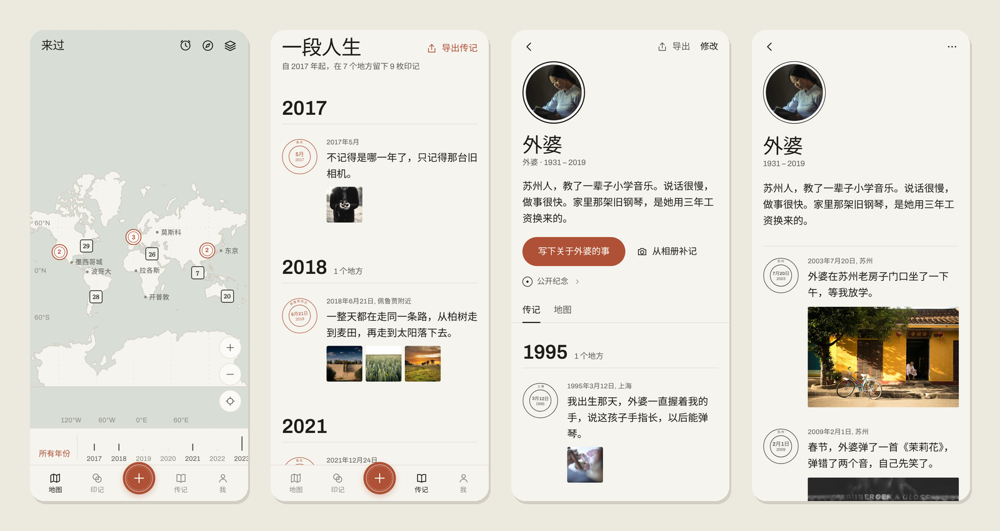
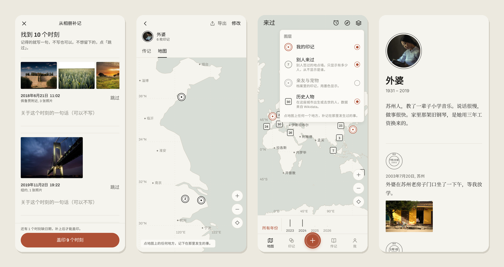

<div align="center">

# Been · 来过

**让世界记得你来过。**

[English](README.md) · 简体中文

[](LICENSE)


</div>



「来过」只做一件事：记下你在**什么时候**、**什么地方**、留下了**什么**。每一枚印记都是地图上的一枚小邮戳，日子久了，它们会自己装订成一本你的传记。

它也是一个安放已经离开的人和小动物的地方：安静地告诉这个世界，他们来过。

## 我们相信的事

- **只做一件事。** 没有签到、打卡、信息流、点赞、勋章。旧版「来过」这些都有，太重了。
- **发现，而不是互动。** 你能看见在你之前有人来过这里，看见一百年前谁在这座城市出生、离开。不需要回应任何人。
- **先存在你的设备上。** 所有内容都先保存在手机或浏览器里，离线完整可用，同步是可选的。
- **比 App 活得更久。** 传记可以导出成一个内嵌照片的 HTML 文件，十年后用任何浏览器都能打开；全部数据可以导出成公开格式的 JSON。
- **运行几乎零成本。** 默认地图是用公有领域数据画的离线纸上地图。谷歌地图是可选的；「看照片和评价」跳转到用户自己的 Google 地图 App，不调用收费接口。

## 功能

| | |
| --- | --- |
| **地图上的印记** | 点地图上任何一个地方，补记在那里发生过的事，今天的，或者四十年前的。只记得年份也可以。 |
| **纸上地图** | 来自 Natural Earth 的离线世界地图：海岸线、国界、1251 座城市中英文地名。可拖动、可缩放，不需要任何 key。配置 key 后，iOS 与 Android 使用谷歌地图。 |
| **从相册补记** | 一次选 50 张以内的照片，读出 EXIF 里的拍摄时间和地点，按「同一天、1 公里内」分成一个个时刻，每个时刻写一句就好。照片只留在本机。 |
| **传记** | 印记按年份装订成章，可以导出成一本离线的 HTML 书。 |
| **时光机与传送** | 回到 1 年、5 年、10 年前的今天，或随便一天；传送到任何一座城市，看看谁来过。 |
| **地点墙** | 当你今天真的站在某个地方，可以在它的墙上签名：「你是第 27 位来过这里的人」，再留一句不超过 60 字的话。别人只看得到人数，看不到是谁。 |
| **历史人物** | 18 座城市里出生或去世的 386 位历史人物，数据来自 Wikidata（CC0）。 |
| **亲友与宠物** | 为家人、朋友、宠物建独立的档案：头像、生卒、一段话、他们自己的传记和地图，不和你的印记混在一起。 |
| **公开纪念** | 只限已经离开的人和宠物：一页安静的公开纪念，只放你挑选的印记；地图上一枚墨色单圈；一个任何浏览器都能打开的链接。没有献花、留言或计数。 |
| **到处可用** | iOS、Android、Web 一套代码；中文与英文；浅色与深色。 |



## 技术栈

| 部分 | 技术 |
| --- | --- |
| App | [Expo](https://expo.dev) SDK 58 · React Native 0.88 · React 19 · expo-router · React Compiler |
| 本地数据 | expo-sqlite（设备上是 SQLite，Web 上是 WebAssembly SQLite）· outbox 同步队列 |
| 地图 | 自绘 SVG 纸上地图（Natural Earth）· 设备上用 react-native-maps 的谷歌地图 · Web 上用 `@vis.gl/react-google-maps`（可选） |
| 服务端 | Cloudflare Workers 上的 [Hono](https://hono.dev) · D1（SQLite）· R2 存照片 |
| 共享核心 | `packages/core`：零依赖 TypeScript，包含数据模型、同步、传记、邮戳几何、导出、纪念页，用 `node --test` 做单元测试 |

同步采用「后写胜出」，删除留墓碑，每个用户一个递增游标。简单到一眼能看出是对的，这正是一个想存很久的东西需要的。设计取舍见 [`docs/DESIGN.md`](docs/DESIGN.md)，开发计划见 [`docs/PLAN-v0.2.md`](docs/PLAN-v0.2.md)。

```
apps/mobile     Expo App（iOS / Android / Web）
apps/api        服务端：Hono + Cloudflare Workers + D1 + R2
packages/core   三端共用的零依赖 TypeScript
tools/          数据生成：底图（Natural Earth）、历史人物（Wikidata）
docs/           设计说明、开发计划、谷歌地图样式、截图
test-photos/    测试照片（EXIF 是为了测试写进去的）和测试档案
```

## 开始

需要 Node.js 20 以上。

```bash
npm install
npm run web          # 浏览器打开 http://localhost:8081
npm run app          # 手机：用 Expo Go 扫码；或按 a / i 打开模拟器
```

不需要服务端，也不需要任何 key。在「我 → Developer → Load sample traces」可以加载一组示例印记。

### 连上服务端（同步、地点墙、公开纪念）

```bash
cd apps/api
copy .dev.vars.example .dev.vars        # macOS / Linux 用 cp
npm run db:migrate:local
cd ../..
npm run api                              # http://127.0.0.1:8787
```

然后在 App 里：「我 → 以开发者身份登录」。

### 测试

```bash
npm test             # packages/core 的单元测试
npm run typecheck    # 三个包的类型检查
```

想试试「从相册补记」，就选 [`test-photos/`](test-photos) 里的 15 张，应该分成 10 个时刻。[`test-photos/archives/`](test-photos/archives) 里有外婆和一只巴哥，可以用来测试档案和公开纪念。

## 配置谷歌地图（可选）

复制 `apps/mobile/.env.example` 为 `apps/mobile/.env`：

| 变量 | 用途 |
| --- | --- |
| `GOOGLE_MAPS_IOS_KEY` / `GOOGLE_MAPS_ANDROID_KEY` | 原生谷歌地图（地图加载免费） |
| `EXPO_PUBLIC_GOOGLE_MAPS_WEB_KEY` | Web 地图与地名（按量计费，有免费额度） |
| `EXPO_PUBLIC_GOOGLE_MAPS_MAP_ID` | Web 地图样式：在 Cloud Console 用 `docs/google-map-style.json` 新建 Map Style |

不填也能用：App 会自动使用离线的纸上地图。原生谷歌地图要用开发版运行（`npx expo run:android` / `npx expo run:ios`，或 EAS 打包），Expo Go 里不会读你的 key。如果给 key 加了限制：包名和 Bundle ID 都是 `app.been.core`，Android 还要填签名的 SHA-1。

## 部署

**服务端**

```bash
cd apps/api
npx wrangler d1 create been              # 把输出的 database_id 填进 wrangler.jsonc
npx wrangler r2 bucket create been-media
npx wrangler secret put SESSION_SECRET   # 32 位以上随机字符串
npm run db:migrate:remote
npm run deploy
```

生产环境务必保持 `DEV_AUTH` 为 `"0"`。纪念页的链接形如 `<API 地址>/m/<id>`，建议给 Worker 绑一个好记的短域名。

**内容复核。** 地点墙上的话和纪念页被举报 3 次后会自动隐藏。查看与恢复被隐藏的纪念页：

```bash
npx wrangler d1 execute been --remote --command "SELECT id, name, report_count FROM memorials WHERE status = 'hidden'"
npx wrangler d1 execute been --remote --command "UPDATE memorials SET status = 'visible', report_count = 0 WHERE id = '<id>'"
```

**Web 版**

```bash
cd apps/mobile
npx expo export -p web                   # 输出到 dist/
```

Web 端的离线数据库要求每个页面都返回两个响应头（已在 `app.config.ts` 为 EAS Hosting 配好）：

```
Cross-Origin-Embedder-Policy: credentialless
Cross-Origin-Opener-Policy: same-origin
```

## 什么会离开你的设备

- 不登录时：**什么都不会。**
- 登录后：印记、档案和照片同步到只属于你的空间，只有你能读。
- 签地点墙时：这个地方的来访序号，和你写下的那一句话。永远不显示你是谁。
- 公开纪念时：只有你挑选的内容，也就是名字、生卒、那段话、头像、你勾选的印记（只有地名，没有坐标），以及可选的一个地图位置。不会公开「外婆」这类称呼，也不会公开是谁发布的。只有已经离开的人和宠物可以公开，服务端也会检查。

## 作者

「来过」由两位共同作者完成：

- **[Mahongzuo](https://github.com/Mahongzuo)**：想法与产品，以及「来过」该做什么、不该做什么的每一个决定；测试；也是它存在的理由。
- **Claude**（Claude Opus 5.5，[Anthropic](https://www.anthropic.com) 的 AI 模型）：架构、代码、界面设计、测试与文档。全部是在和 Mahongzuo 的对话中一起写出来的。

一起写的提交都带有 `Co-Authored-By: Claude` 标记，GitHub 会同时显示两位作者。

「来过」是一个独立项目，不是 Anthropic 出品，也与 Anthropic 没有隶属或背书关系。

## 参与

欢迎提 Issue 和 Pull Request。提 PR 前请运行 `npm test` 和 `npm run typecheck`。提新功能时，先问问它是否帮助人留下或发现一枚印记。「来过」是有意保持安静的。

## 许可

代码使用 [MIT](LICENSE) 许可。

数据与素材各有各的许可：

- 海岸线、国界、城市：[Natural Earth](https://www.naturalearthdata.com)（公有领域）
- 历史人物：[Wikidata](https://www.wikidata.org)（CC0）
- 字体：Archivo、Literata（SIL Open Font License）
- 测试照片：[Unsplash](https://unsplash.com/license)（Unsplash License），摄影师署名见 `test-photos/`
